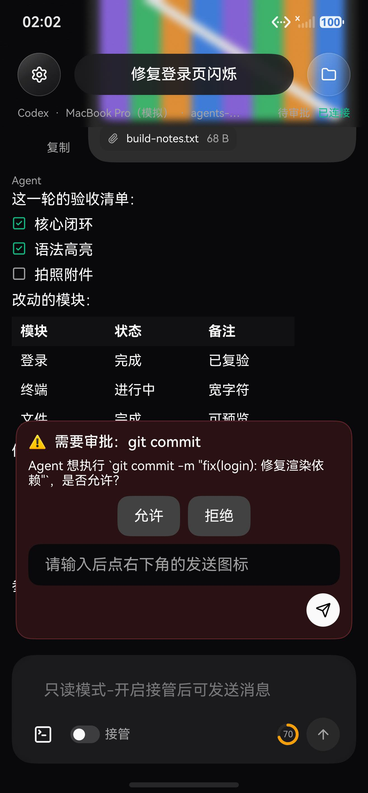
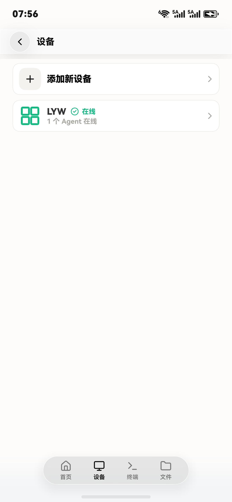
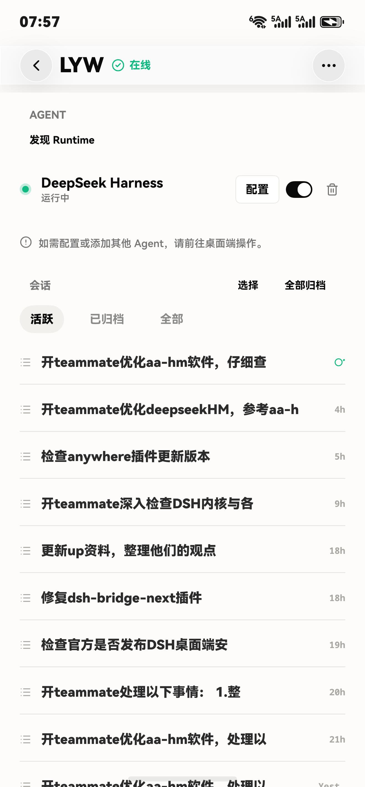
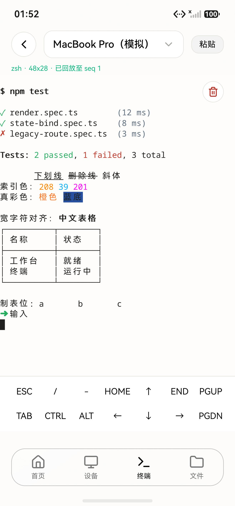
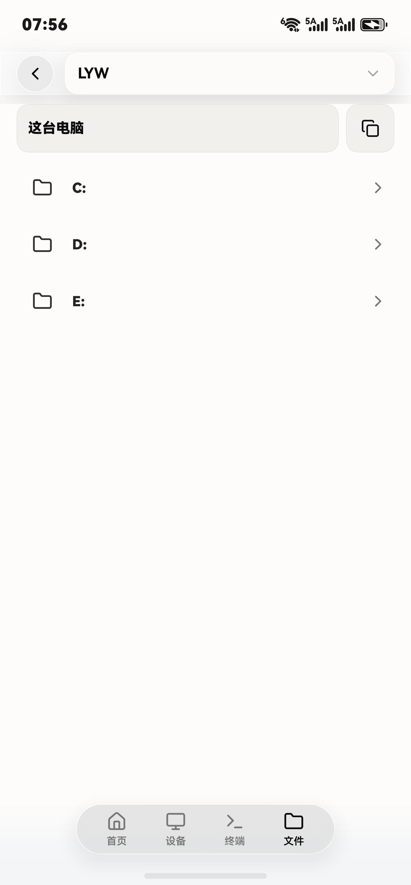
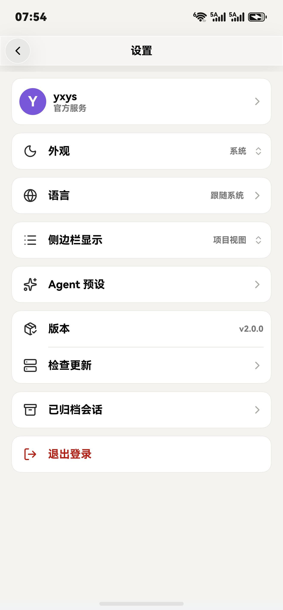
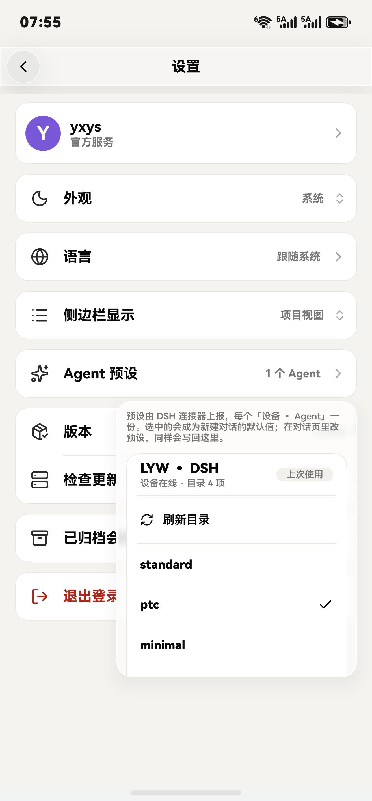

# aa-hm · Agents Anywhere 鸿蒙客户端

> **上游与归属**：本仓库是开源项目 **[Agents Anywhere](https://github.com/anywhere-labs/Agents-Anywhere)** 的**鸿蒙端适配**。
> 上游项目由 [anywhere-labs](https://github.com/anywhere-labs) 维护，官网 [agents-anywhere.com](https://www.agents-anywhere.com)，
> 上游版权标识为 Copyright (c) 2026 Agents Anywhere Contributors，以上游 README「开源许可」章节与 dsh-bridge/LICENSE 载明的 **MIT** 许可发布。
> 具体做法是：把上游的 **Android 原生客户端**（Kotlin + Jetpack Compose，约 4.2 万行）改写为**鸿蒙原生应用**（ArkTS + ArkUI，Stage 模型）。
> ⚠️ 本仓库**不是上游官方发布**，与上游 Android / iOS / 桌面 / Web 客户端是**并存关系**。完整归属、第三方组件与上游 MIT 许可全文见 [NOTICE.md](NOTICE.md)。

Agents Anywhere 是跨设备的 Agent 工作台：工作电脑上跑 Connector，把 Codex / Claude Code / DeepSeek Harness 等 Agent 的会话暴露出来；手机端负责**查看进展、回复 Agent、处理审批、浏览工作区文件、开远程终端**。本项目是它的鸿蒙端实现：80 个 `.ets` / 51,210 行 ArkTS，覆盖登录、工作台、会话详情、审批与提问、附件、文件浏览与文本预览、以及一套**自研的 VT 终端仿真**（不依赖 ArkUI，可独立单测）。

> 面向 HarmonyOS 7 / API 26。当前版本 `2.0.0`，MIT 许可。

## 界面

| 首页（浅色） | 首页（深色） | 会话详情 |
| --- | --- | --- |
|  |  |  |
| 工作台：项目分组会话、置顶区、设备 / 终端 / 文件快捷入口 | 同一页面在深色主题下的效果 | 时间线、Markdown 富渲染、审批卡、底部输入区（接管开关 + 发送 / 中断） |

| 设备 | 设备详情 | 终端 |
| --- | --- | --- |
|  |  |  |
| 设备列表与配对新设备入口 | Runtime 发现 / 启停 / 配置，会话区可筛选与批量归档 | 自研 VT 仿真 + Canvas 网格渲染，含回看、宽字符与附加按键行 |

| 文件 | 设置 | Agent 预设 |
| --- | --- | --- |
|  |  |  |
| 目录浏览、面包屑、文本预览与按文件名猜语言的语法高亮 | 外观 / 语言 / 侧边栏显示 / 版本与更新 | 由 Connector 上报的 Agent 预设，选中项会写回新建对话的默认值 |

> 截图取自项目验收记录，分辨率均为 `1316×2832`。其中**首页（浅色 / 深色）、会话详情、终端**为模拟器拍摄，**设备、设备详情、文件、设置、Agent 预设**为真机拍摄。界面文案为简体中文，实际以设备为准。

## 功能特性

### 登录与账号

| 能力 | 说明 |
| --- | --- |
| 服务器地址校验 | 首次连接前先探 `/health` 与 `/auth/config`；官方 Cloud 为默认值，也可填自建实例 |
| 密码登录 / 注册 | 邮箱 + 密码；是否开放注册由服务端 `auth/config` 决定 |
| 扫码登录 | 粘贴网页端二维码内容，走 `request` / `status` / `exchange` 三段式轮询 |
| 网页 OAuth 登录 | PKCE（S256），在 ArkWeb 内拦截 `agents-anywhere://oauth/callback` 回调后立即关闭 |
| 会话持久化 | 令牌落在应用私有 preferences；401 会精确清理登录态 |
| 资料维护 | 修改昵称、邮箱、密码 |

### 工作台与会话

| 能力 | 说明 |
| --- | --- |
| 工作台 | 设备 / 项目分组会话，进行中与已归档切换；由 `dashboard` WebSocket 的全量快照驱动 |
| 会话列表分页 | 游标状态机 + 按 id 去重；快照合并不覆盖已加载的后续页，底部提供「加载更多 / 重试」 |
| 会话详情 | `snapshot` + 时间线；事件按 34ms 窗口合批，断线退避重连并以游标恢复 |
| 审批与提问 | 渲染 `runtime/notices` 的全部动作，以及 `input.required` 文本输入，回 `runtime/notices/{id}/respond` |
| 消息与接管 | 发送 / 运行中自动改走 `steer` / 中断 / 接管（takeover） |
| 运行时选型 | 模型、推理强度、权限模式三段选择，点选后等**服务端回显**（不做本地乐观态） |
| Agent 预设 | 展示 Connector 上报的预设目录，选中项写进「上次选择」记忆；开窗时自动刷新目录 |
| 会话行操作 | 重命名 / 置顶 / 归档 / 标记已读，含二次确认 |
| 新建对话 | 「+」→ 选择工作区 → 直接进入对话页草稿态，首条消息发出时才真正创建会话 |
| 附件 | 文件选择器 → 多部分上传 → 随消息发送；下载做 base64 + 体积 + SHA-256 三重校验，图片可内联渲染并放大查看 |

### 设备、文件与终端

| 能力 | 说明 |
| --- | --- |
| 设备管理 | 两步向导配对（先建后领）、撤销设备令牌（二次确认）、Runtime 发现 / 启停 / 清除配置 |
| 文件浏览 | 目录导航、面包屑、过滤、按会话工作区（cwd）为根浏览 |
| 文本预览 | 按扩展名与文件名判定能否按文本预览；编码 / 截断 / 二进制标记；文件内搜索与复制路径 |
| 自研 VT 终端 | C0 / ESC / CSI / OSC / DCS 转义序列，SGR 全量属性、256 色与真彩色、备用屏、边距滚动、制表位、resize、宽字符、括号粘贴 |
| 终端交互 | Canvas 网格渲染、回看（拖拽翻历史）、附加按键行、软键盘流式输入、剪贴板粘贴 |

### 界面与渲染

| 能力 | 说明 |
| --- | --- |
| 主题 | 跟随系统 / 浅色 / 深色；设计令牌统一走资源双值 |
| Markdown 富渲染 | 标题、嵌套列表、引用、代码块、表格、任务清单、分隔线、可点链接、行内粗斜体删除线、远程图片 |
| 代码高亮 | 纯 ArkTS 语法着色器，15 个语言档 + 别名归一，逐 token 上色，超长自动退回纯文本 |
| 沉浸光感 | 按 HarmonyOS 7 的生效范围约束接入官方材质，范围外使用自绘毛玻璃回退 |
| 返回键 | 页面内部子页可优先消费系统返回键，逐级回退而不是直接退出整页 |

## 技术栈

| 层 | 选型 |
| --- | --- |
| 语言 | ArkTS（静态类型，禁用动态属性） |
| UI 框架 | ArkUI 声明式（`@Component` / `@State` / `@StorageLink` / `@Builder`） |
| 应用模型 | Stage 模型，单 `entry` HAP 模块 |
| 网络 | `@kit.NetworkKit` 的 `http` 与 `webSocket` |
| 存储 | `@kit.ArkData` 的 preferences（令牌、草稿、界面偏好） |
| 网页登录 | `@kit.ArkWeb`（Web 组件，仅用于 OAuth 回调拦截） |
| 取色 / 摘要 | 自实现 Base64 与 SHA-256（纯 ArkTS，无 Kit 依赖，便于单测） |
| 测试 | Node.js 直接跑非 ArkUI 模块的逻辑断言（36 个套件，其中 2 个在开源仓库中显式跳过） |

## 架构速览

```text
entry/src/main/ets/
├── api/        HTTP / WS 传输与线格式归一化（ApiUrls / ApiClient / Parse / *Api）
├── model/      共享模型与纯逻辑（wire DTO、排序与派生、路径与文本判定）
├── store/      本地持久化（preferences）
├── feature/    功能层，不画 UI（各 Store + 时间线投影 + 单例组装）
├── vt/         自研 VT 终端仿真（不依赖 ArkUI，可在 Node 里单测）
├── ui/         ArkUI 层（设计令牌、通用组件、显式路由栈、Markdown、语法高亮、screens/）
├── utils/      Codec（Base64）与 SHA-256
├── dev/        构建期全量模块类型检查探针
└── pages/      根页面：登录态门控 + 路由分发
```

两条关键设计取舍（理由与边界见 [docs/ARCHITECTURE.md](docs/ARCHITECTURE.md)）：

- **自研 VT 终端仿真**：仿真内核只做「字节流 → 屏幕网格」的纯计算，不引用 ArkUI，因此可以在 Node 里跑几万条断言；渲染层只负责把网格画到 Canvas 上。
- **显式路由栈**：本应用页面层级很浅（根 + 若干详情页），用自管理的栈 + `AppStorage` 字符串键，比 `Navigation` / `NavPathStack` 更容易控制返回行为，也省掉目的地注册与参数序列化的样板。

## 环境要求

| 项 | 要求 |
| --- | --- |
| DevEco Studio | 支持 HarmonyOS 7 SDK 的版本（含自带 Node.js 与 hvigor） |
| HarmonyOS SDK | API 26（`compatibleSdkVersion` = `targetSdkVersion` = `26.0.0`，`runtimeOS: HarmonyOS`） |
| 设备 | 手机或平板（`deviceTypes: phone, tablet`），HarmonyOS 7 |
| 服务端 | 一个可访问的 Agents Anywhere 实例（见下节） |

## 快速开始

### 1. 准备服务端

本应用是纯客户端，**必须先有一个 Agents Anywhere 服务端**：

- **官方 Cloud**：`https://web.agents-anywhere.com`（登录页的默认地址）；
- **自建实例**：在登录页「服务器地址」里填写你的实例地址。地址只接受 `http` / `https`，可带端口与 `/api/v2` 后缀；局域网地址会自动按 `http` 处理。

登录之后还需要**至少一台在线设备**：在作为工作机的电脑上运行 Agents Anywhere 的 Connector，并在应用里配对（设备页 → 添加新设备）。终端的可用性同样取决于该设备上是否已启用对应的 Runtime。

### 2. 打开工程并签名

```text
DevEco Studio → Open → 选择本仓库根目录
File → Project Structure → Signing Configs → 勾选 Automatically generate signature
```

自动签名需要登录华为账号，DevEco 会把签名材料生成到用户目录并写回本机的 `build-profile.json5`。**该文件含加密口令，已被 `.gitignore` 排除，不要提交**；仓库里提供 [build-profile.example.json5](build-profile.example.json5) 作为结构参考。

> **关于 bundleName**：本仓库的 `bundleName` 是 `aa234.luoyaowen.23`。它是 DevEco 的自动签名流程为「尚未注册的 bundle」分配并绑定的 ID——签名 Profile 与 bundleName 必须一致，DevEco 会据此改写 `AppScope/app.json5`。因此开源时保留了这个原值：**改动它需要重新签名**（换用自己的开发者账号与包名），不能只改一行配置。如果你要发布自己的分支，请把 bundleName 改成自己的并在自己的账号下重新签名。

### 3. 运行

连接设备（开启 USB 调试）或启动模拟器，选择 `entry` 模块后点击 Run。命令行构建、零告警口径、逻辑自测与模拟服务端的完整步骤见 [docs/DEVELOPMENT.md](docs/DEVELOPMENT.md)。

## 目录结构

```text
./
├── AppScope/                   应用级配置（bundleName、版本、图标）
├── entry/                      入口模块（源码、资源、模块级配置）
├── specs/                      上游 v2 API 协议契约（实现依据）
├── tools/                      开发与验收工具（见下）
├── docs/                       面向社区的文档
├── build-profile.json5         本机构建与签名配置（不入库，示例见 .example 文件）
├── hvigorfile.ts / hvigor/     构建脚本与 hvigor 配置
└── oh-package.json5            工程元信息（名称 / 版本 / 许可）
```

`tools/` 里对贡献者最有用的几个：

| 工具 | 用途 |
| --- | --- |
| `logic-test/run-all.mjs` | 逻辑自测全量入口：主套件 + 各专项套件，**无需设备** |
| `mock-server/server.mjs` | 零依赖模拟服务端，按 [specs/01-api-spec.md](specs/01-api-spec.md) 提供 HTTP + WebSocket |
| `device-ctl.mjs` | 设备自动化：先取控件真实坐标再点击 / 键入 / 截图 / 回读 |
| `build-locked.mjs` | 串行化构建：文件锁 + 构建 + 校验 + 冻结产物（多终端并发构建时会互相覆盖中间产物） |
| `material-audit.mjs` | 沉浸光感接入点审计（按组件归属统计） |

## 自测

```bash
node tools/logic-test/run-all.mjs      # 全部套件；退出码 0 = 全绿，可直接当 CI 判据
node tools/logic-test/run-tests.mjs    # 只跑主套件（会漏掉各专项套件，不建议单独用）
```

共 36 个套件；其中 **2 个依赖开发期的内部性能基线与证据文档，在开源仓库中会显式跳过（SKIP）**，其余全部通过。跳过项会明确打印原因，**不是**静默通过；单条断言的条数随版本变化，以实际输出为准。

这些断言把**不依赖 ArkUI / Kit 的模块**（`api/ApiUrls`、`api/Parse`、`model/*`、`feature/TimelineProjection`、`vt/*`、`utils/Sha256`、`ui/MarkdownParse`、`ui/SyntaxHighlight` 等）在 Node 里直接跑，覆盖地址归一化与路由回退、DTO 别名回退、能力判定、会话排序与标签、时间线投影与 upsert 合并、VT 转义序列、字符宽度、Markdown 与语法着色、远程路径判定、SHA-256 的 NIST 向量等。

模拟服务端可以把「登录之后」的整条链路在**没有真实账号**的情况下跑通：

```bash
node tools/mock-server/server.mjs --port 8787
# 然后把应用的服务器地址填成 http://<本机地址>:8787，用任意邮箱 + 任意非空密码登录
```

更多细节（含真机 / 模拟器调试与签名流程）见 [docs/DEVELOPMENT.md](docs/DEVELOPMENT.md)。

## 已知限制

以下是**当前版本尚未实现**的项，如实列出，避免误解：

- 终端文本选择与复制：目前支持全屏选中与剪贴板粘贴，鼠标事件已解析但未上报；
- 会话正文的文本选择与复制；
- 相机拍照附件：只做文件选择器上传；扫码登录目前是「粘贴二维码内容」，未接入系统扫码；
- 头像更换与应用内更新安装：只提示「有新版」并给出发布页，不下载安装；
- 语法高亮是正则 / 状态机实现（15 个语言档），不支持语义级着色与增量重算；
- 「这台电脑」式的 Windows 驱动器总览尚未接入。

## 文档

| 文档 | 内容 |
| --- | --- |
| [docs/ARCHITECTURE.md](docs/ARCHITECTURE.md) | 分层职责、数据流、VT 仿真与路由栈的设计取舍 |
| [docs/DEVELOPMENT.md](docs/DEVELOPMENT.md) | 环境搭建、命令行构建、零告警口径、逻辑自测、模拟服务端、设备调试、签名流程 |
| [docs/CONTRIBUTING.md](docs/CONTRIBUTING.md) | 分支与提交规范、自测要求、PR 流程 |
| [docs/ARKTS-PITFALLS.md](docs/ARKTS-PITFALLS.md) | ArkTS / ArkUI 实战踩坑集（状态与刷新、布局与命中、材质与模糊、导航栏、终端与流式、构建） |
| [specs/01-api-spec.md](specs/01-api-spec.md) | 上游 v2 API 契约：端点表、事件信封、终端帧格式 |

## 上游与致谢

本项目的**上游原作者与项目**如下（完整声明见 [NOTICE.md](NOTICE.md)）：

| 项 | 内容 |
| --- | --- |
| 上游项目 | **Agents Anywhere**（跨设备的开源 Agent 工作台） |
| 上游地址 | [github.com/anywhere-labs/Agents-Anywhere](https://github.com/anywhere-labs/Agents-Anywhere) |
| 上游维护方 | [anywhere-labs](https://github.com/anywhere-labs) |
| 上游版权标识 | Copyright (c) 2026 Agents Anywhere Contributors |
| 上游官网 | [agents-anywhere.com](https://www.agents-anywhere.com) · Web [web.agents-anywhere.com](https://web.agents-anywhere.com) |
| 上游许可 | MIT |

**本开源项目根据上游原项目做鸿蒙端（HarmonyOS）适配**：把上游 Android 客户端（Kotlin + Jetpack Compose）改写为 ArkTS / ArkUI 实现，
协议、交互与信息架构以上游 Android 端为基准；本仓库**不是上游官方发布**，也不包含上游源码。

此外，上游使用的开源生态（Kotlin、Jetpack Compose、Material 3、Termux 终端组件等）为本项目的功能对齐提供了参照；
本项目使用的第三方图标与字体许可见 [NOTICE.md](NOTICE.md#第三方组件)。

## 许可证

本项目以 [MIT License](LICENSE) 发布，版权归 **yxys288** 所有。

本项目是 [Agents Anywhere](https://github.com/anywhere-labs/Agents-Anywhere)（Copyright (c) 2026 Agents Anywhere Contributors，MIT）的**鸿蒙端适配**，
按 MIT 许可保留上游版权声明与许可声明，全文见 [NOTICE.md](NOTICE.md)。
